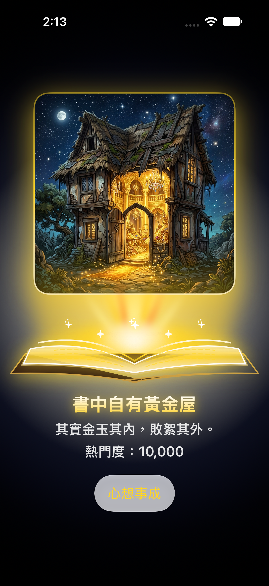
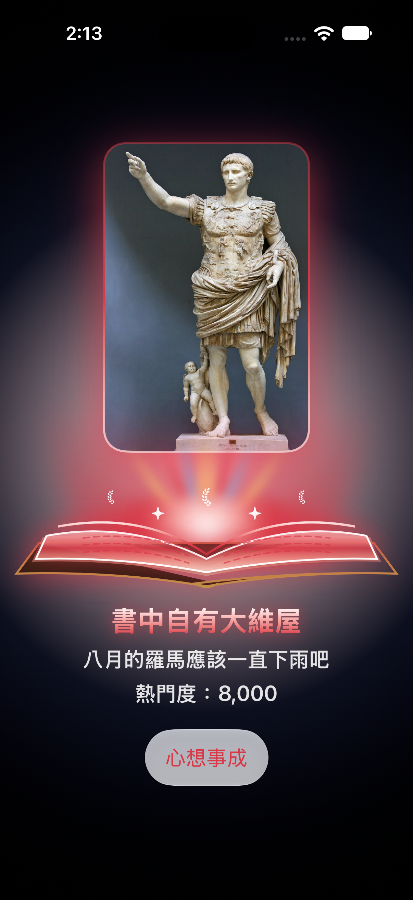

# 📖 書中自有 XX 屋（10.25 SwiftUI 作業）

一款以成語「**書中自有黃金屋**」為靈感發想的 SwiftUI 互動式繪本風 App。  
點擊「**心想事成**」按鈕即可隨機召喚 8 座不同主題的「屋」，且每座屋子底下皆有一本以 SwiftUI `Shape` 與漸層光影繪製的**打開魔法書**——書頁朝上翻開並向上投射動態光束、光暈與主題粒子，光芒色彩會隨屋子本身的特性而自動變化。

> 💡 **AI 協作對話紀錄與重點程式碼講解**：請參閱 [AI_對話紀錄與重點程式碼講解.md](./AI_對話紀錄與重點程式碼講解.md)

---

## 📱 App 畫面預覽

| 書中自有黃金屋 | 書中自有金珍妮屋 | 書中自有大維屋 |
| :---: | :---: | :---: |
|  |  |  |

---

## ✨ 功能特色

1. **八大主題屋子與趣味雙關**
   - 透過自訂資料結構 `maison` 管理每座屋子的圖片名稱（`image`）、名稱（`nom`）、趣味描述（`description`）與人氣值（`popularite`）。
   - 除了五種礦石／貴金屬屋（黃金、黃鐵礦、白金、白銀、鑽石）之外，還結合諧音與流行文化梗加入「金珍妮屋」、「大維屋（屋大維）」與「米奇妙妙屋」。
2. **隨屋子動態變換的發光打開書本（`GlowingOpenBookView`）**
   - **立體展開書頁**：使用自訂 `Shape`（`OpenBookCoverShape`、`OpenBookPagesShape`、`OpenBookInnerLeafShape`）繪製精裝書封、厚書頁層與朝上拱起的受光內頁，並在書頁表面加上發光符文虛線（`BookGlowingTextLines`）。
   - **朝上投射光束與光暈**：結合 `UpwardLightConeShape` 光束錐、7 道放射狀漸層光束條與核心橢圓光暈，由朝上的書頁往屋子底部發光。
   - **主題粒子與呼吸燈動畫**：搭配 `isGlowing` 狀態進行持續的柔和呼吸縮放動畫，並依各屋子主題浮現專屬 SF Symbols 微光粒子（如皇冠、鑽石、愛心、月桂冠、星星等）。
3. **Liquid Glass 風格互動按鈕**
   - 使用 `.buttonStyle(.glass)` 搭配 `.tint(currentMaison.primaryGlowColor)`，讓「心想事成」按鈕與當前屋子的光芒色系無縫呼應，點擊時以彈簧動畫（`.spring`）隨機切換屋子。

---

## 🏠 收錄屋子一覽

| 屋子標題 | `nom` | 描述（`description`） | 人氣值（`popularite`） | 書頁光芒配色 | 粒子符號（SF Symbols） |
| :--- | :--- | :--- | :---: | :--- | :--- |
| **書中自有黃金屋** | `黃金` | 其實金玉其內，敗絮其外。 | `10000` | 璀璨純金與暖橘漸層 | `sparkles` |
| **書中自有黃鐵礦屋** | `黃鐵礦` | 如假包換，瞞天過海 | `-10000` | 愚人金黃銅與暗礦綠漸層 | `cube.fill` |
| **書中自有白金屋** | `白金` | 怨嗟無一世英主我顧啊 | `800` | 冰藍月光與純白鉑金漸層 | `crown.fill` |
| **書中自有白銀屋** | `白銀` | 淡泊如淵明，協臥五柳樹下 | `1500` | 柳青銀白與淡雅湖水綠漸層 | `leaf.fill` |
| **書中自有鑽石屋** | `鑽石` | 鋒芒畢露，耀眼奪目 | `1000000` | 稜鏡青藍、紫粉與七彩星光 | `diamond.fill` |
| **書中自有金珍妮屋** | `金珍妮` | Hit you with that Dhu-dhu-du | `99999` | BLACKPINK 霓虹粉紅與紫紅漸層 | `heart.fill` |
| **書中自有大維屋** | `大維` | 八月的羅馬應該一直下雨吧 | `8000` | 羅馬帝國緋紅與雷雨金藍漸層 | `laurel.leading` |
| **書中自有米奇妙妙屋** | `米奇妙妙` | 好帥好帥今天的精彩 | `100` | 米奇亮紅、金黃與繽紛歡樂色系 | `star.fill` |

---

## 🧠 重點程式碼講解

### 1. 資料模型與動態主題計算屬性（`maison.swift`）
在 `maison` 結構中，除了儲存基本屬性（`image`、`nom`、`description`、`popularite`）外，還運用了 Swift 的**計算屬性（Computed Properties）**，讓每筆資料自動對應專屬的光芒顏色與粒子符號：

```swift
struct maison {
    let image: String
    let nom: String
    let description: String
    let popularite: Int

    /// 主光芒顏色（依屋子本身而改變）
    var primaryGlowColor: Color {
        switch nom {
        case "黃金":
            return Color(red: 1.0, green: 0.84, blue: 0.15)
        case "黃鐵礦":
            return Color(red: 0.76, green: 0.68, blue: 0.22)
        // ... 依不同屋子回傳專屬代表色
        }
    }
}
```
透過 `primaryGlowColor`、`glowColors` 與 `sparkleSymbol` 三個計算屬性，讓 `ContentView` 不需撰寫重複的條件判斷即可直接套用主題色。

### 2. 狀態管理與隨機抽屋動畫（`ContentView.swift`）
- `@State private var selecteMaisonIndex = 0`：記錄目前顯示的屋子索引，點擊「心想事成」時以 `.random(in: maisons.indices)` 隨機抽取，並透過 `withAnimation(.spring(...))` 驅動平滑過渡動畫。
- `@State private var isGlowing = false`：於 `.onAppear` 啟動 `.repeatForever(autoreverses: true)` 無限呼吸燈動畫，讓光束與粒子產生持續浮動的魔法感。

### 3. 自訂 `Shape` 繪製朝上發光的打開書本（`GlowingOpenBookView`）
`GlowingOpenBookView` 以 `ZStack(alignment: .bottom)` 疊加五個層次：
1. **`UpwardLightConeShape`**：繪製由書頁往上擴散的梯形光束錐，搭配 `LinearGradient` 與 `.blur(radius: 14)` 營造柔和光霧。
2. **放射狀光束條**：使用 `ForEach(0..<7)` 產生 7 道 `Capsule` 光束，並以 `.rotationEffect(.degrees(angle), anchor: .bottom)` 呈扇形朝上發散。
3. **核心橢圓光暈**：以 `RadialGradient` 在書頁正上方製造高光核心。
4. **主題微光粒子**：讀取 `maison.sparkleSymbol` 顯示對應 SF Symbols（如皇冠、鑽石、愛心、月桂冠、星星）。
5. **立體書封與朝上拱起的書頁（`OpenBookCoverShape`、`OpenBookPagesShape`）**：利用二次貝茲曲線 `addQuadCurve(to:control:)` 將左右書頁控制點向上拉高，呈現書頁朝上翻開並受光發亮的立體感。

---

## 🗂 專案結構

```text
10.25 作業/
├── 10.25 作業/
│   ├── MyApp.swift                     # App 進入點 (@main)
│   ├── ContentView.swift               # 主畫面、GlowingOpenBookView 與自訂書本/光束 Shape
│   ├── maison.swift                    # maison 資料模型與各屋子專屬光芒色彩/粒子屬性
│   └── Assets.xcassets/                # 8 座屋子的圖片資源
├── AI_對話紀錄與重點程式碼講解.md       # 與 AI 協作的完整對話整理與重點程式碼解析
├── README.md                           # 專案說明文件
├── maisonenor.png                      # App 預覽截圖（黃金屋）
├── maisondejennie.png                  # App 預覽截圖（金珍妮屋）
└── maisondempereur.png                 # App 預覽截圖（大維屋）
```

---

## 🛠 開發環境與執行方式

1. **系統需求**：macOS + Xcode（支援 SwiftUI 及 `.buttonStyle(.glass)` 之 iOS SDK）
2. **開啟專案**：
   ```bash
   git clone https://github.com/philix-felix/1025hw.git
   cd 1025hw
   open "10.25 作業.xcodeproj"
   ```
3. 在 Xcode 中選擇 iPhone 模擬器或開啟右側 `#Preview` 畫布，點擊畫面下方的「**心想事成**」按鈕即可體驗隨機換屋與書頁發光變化效果。
